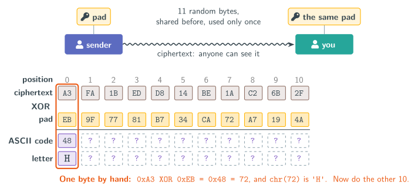

# Task 1: decrypt a message

## The situation

You are Bob. Alice wants to give you a short secret message. Before, you met and both got the same 11 random bytes: the **one-time pad**. Alice XORed the message with the pad and sent the result, the ciphertext, where anyone can see it. Without the pad it is noise. With the pad, you can read it.



## Goal

Print the secret message.

## Ready for you

- `decrypt.py`: two lists of 11 numbers, `ciphertext` and `pad`, already filled in:

```
ciphertext  A3 FA 1B ED D8 14 BE 1A C2 6B 2F
pad         EB 9F 77 81 B7 34 CA 72 A7 19 4A
```

## Steps

Write your code in place of the `TODO` comments in `decrypt.py`. The loop is ready:

```python
plaintext = ""
for i in range(len(ciphertext)):
    # TODO 1 and TODO 2 go here
```

1. Inside the loop, XOR the ciphertext byte with the pad byte at the same position: `x = ciphertext[i] ^ pad[i]` (`^` is XOR, as in C).
2. Still inside the loop: `x` is an ASCII code. Turn it into a letter and add it to the message: `plaintext = plaintext + chr(x)`. `chr(72)` gives `H`, like the cast `(char)72` in C.
3. Print the whole message: replace the line `print("not done yet: TODO 3")` with `print(plaintext)`.

Until a step is done, the program prints `not done yet: TODO n`, with the number of the first step that is missing.

## Expected output

One line: the message, 11 characters, starting with `H`.

<details>
<summary>Check your answer</summary>

```
Hello there
```

</details>

## Run

```
python3 decrypt.py
```

About 5 minutes. Python 3, no extra libraries.
