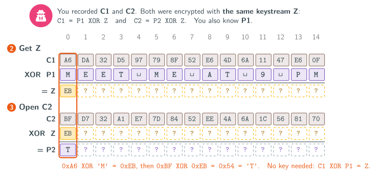

# Task 3: one key, two messages

## The situation

Alice made a mistake: two messages to Bob were encrypted with the same key, so with **the same keystream Z**. You are Eve: you recorded both ciphertexts, C1 and C2. From a reliable source you know the first message: `MEET ME AT 9 PM`. That is enough to read the second message, without the key.



## Goal

Print the second message, without knowing the key.

## Ready for you

- `reuse.py`: the two ciphertexts `c1`, `c2` (15 bytes each) and the known first message `p1`:

```
C1  A6DA32D597798F52E64D6A1147E60F
C2  BFD732A1E77D8452EE4A6A1C568170
P1  MEET ME AT 9 PM
```

## Steps

Write your code in place of the `TODO` comments in `reuse.py`:

1. Write `xor_bytes(a, b)`: XOR byte `i` of `a` with byte `i` of `b`, for every `i`. Collect the results in a list and return `bytes(list)`.
2. Get the keystream: `C1 = P1 XOR Z`, so `Z = C1 XOR P1`. Use `xor_bytes(c1, p1)`.
3. Decrypt `c2` with that keystream and print it, in place of `print("not done yet: TODO 3")`. `.decode()` turns bytes into text.

Until a step is done, the program prints `not done yet: TODO n` for it.

```python
def xor_bytes(a, b):
    out = []
    for i in range(len(a)):
        pass  # TODO 1: append a[i] ^ b[i] to out
    return bytes(out)
```

## Expected output

One line: the second message, 15 characters, starting with `T`.

<details>
<summary>Check your answer</summary>

```
THE PIN IS 4172
```

</details>

## Run

```
python3 reuse.py
```

About 10 minutes. Python 3, no extra libraries.
