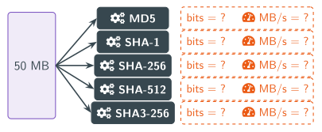

# Task 10: how fast?

## The situation

Bob must choose a hash function for a backup tool that hashes many gigabytes a day. Python's `hashlib` offers MD5, SHA-1, SHA-256, SHA-512 and SHA3-256. How long are their digests, and how many megabytes per second does each hash on your computer?



## Goal

Print the digest size of five hash functions and measure their speed on 50 MB.

## Ready for you

- `speed.py`: the list `NAMES` and `DATA`, 50 MB of zero bytes.

`hashlib.new(name)` makes a hash object by its name, like a function pointer chosen from a table in C; `hashlib.new(name, DATA)` also hashes `DATA` at once. `h.digest_size` is the length of the digest in bytes.

## Steps

1. For each name: `h = hashlib.new(name)`, print the name and `8 * h.digest_size` bits.
2. Predict first: which is the fastest, which the slowest? Then for each name: `t0 = time.perf_counter()`, `hashlib.new(name, DATA).digest()`, `seconds = time.perf_counter() - t0`, and print `50 / seconds` MB/s.

## Expected output

Five sizes, then five speeds. Your speeds will differ (they depend on the processor and even change between runs), but the sizes will not.

<details>
<summary>Check your answer</summary>

```
md5       128 bits
sha1      160 bits
sha256    256 bits
sha512    512 bits
sha3_256  256 bits
md5          435 MB/s
sha1         612 MB/s
sha256       236 MB/s
sha512       329 MB/s
sha3_256     261 MB/s
```

(Intel Core i5-8265U laptop, Python 3.12 with OpenSSL 3.0.13, the best of 5 runs.) All of them hash hundreds of megabytes per second. SHA-256 is the slowest here, and SHA-512 is faster than SHA-256 on a 64-bit processor because it works on 64-bit words and processes 128 bytes per block. Processors with SHA instructions (many newer Intel, AMD and ARM chips) hash SHA-256 several times faster. The broken MD5 and SHA-1 are faster, but speed is no reason to use them.

</details>

## Run

```
python3 speed.py
```

About 6 minutes. Python 3.8 or newer, no extra libraries. It needs about 50 MB of memory and runs for a few seconds.
