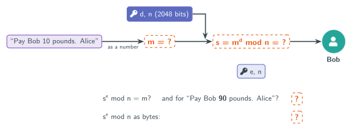

# Task 3: textbook RSA

## The situation

Alice signs a short payment order for Bob with textbook RSA: the message as a number `m`, the signature `s = m^d mod n`. Her key is a real 2048-bit RSA key. Bob checks it with her public key `{e, n}`. Mallory then changes "10 pounds" into "90 pounds" and keeps Alice's signature.



## Goal

Sign and verify with the two powers of RSA, see that a changed message fails, and see what is inside the signature.

## Ready for you

- `alice_key.py`: `n`, `e`, `d` of Alice's key (numbers with about 617 digits; Python integers have no size limit, unlike `int` in C), `number_to_bytes(x)` (the opposite of `int.from_bytes`) and `short(x)` for printing.
- `int.from_bytes(data, "big")`: the bytes read as one big-endian number, as in Lecture 3.
- `pow(m, d, n)`: m to the power d, mod n, fast (Lecture 3).

## Steps

Write your code in place of the `None` after each `TODO` in `textbook_rsa.py`:

1. `m`: the message as a number.
2. `s`: Alice's signature, `pow(m, d, n)`.
3. `check`: Bob's check, `pow(s, e, n) == m`.
4. `check_changed`: turn `changed` into a number and check it with the same `s`.
5. `inside`: `pow(s, e, n)` turned back into bytes with `number_to_bytes`.

Before step 5, predict: what will the bytes say?

## Expected output

<details>
<summary>Check your answer</summary>

```
m = 50617920426f...20416c696365 (48 hex digits)  smaller than n: True
s = 1ee3425e9a74...95e50c23a9ae (512 hex digits)
Bob checks the message:         True
Bob checks the changed message: False
s^e mod n as bytes: b'Pay Bob 10 pounds. Alice'
```

The signature has 512 hex digits, 256 bytes, as many as `n`, even for a 24-byte message. The public power gives back exactly the message Alice signed, so the changed message does not fit.

</details>

## Run

```
python3 textbook_rsa.py
```

About 8 minutes. Python 3 and the library `cryptography` (only `alice_key.py` uses it, to read the PEM file).

Want to see it move? The [signatures simulator, step 2](https://ksawerym.github.io/Cryptography-simulators/signatures/#2) does the same on the small key {7, 187} and {23, 187}.
