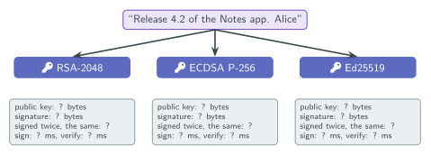

# Task 7: three schemes

## The situation

Alice has three key pairs: RSA-2048, ECDSA on the curve P-256, and Ed25519. She wants to know which to use for signing the releases of her Notes app: how big are the keys and signatures, does the same release signed twice give the same signature, and how fast is each.



## Goal

Measure and compare the three signature schemes on the same message.

## Ready for you

- `schemes.py`: `NAMES` (the three names), `load_keys(name)`, `sign(name, private_key, data)`, `verify(name, public_key, data, sig)`, `public_key_size(name, public_key)`. RSA-2048 is RSA-PSS with SHA-256, as used in practice.
- `three_schemes.py`: a loop over the three names, like `for (i = 0; i < 3; i++)` in C, with the printing ready.
- `time.perf_counter()`: the time in seconds as a float, like `clock_gettime(CLOCK_MONOTONIC, ...)` in C.

## Steps

Write your code in place of the `None` after each `TODO` in `three_schemes.py` (inside the loop):

1. `key_size` with `public_key_size`, and `signature_size` as `len(...)` of one signature.
2. Sign `message` twice into `sig_a` and `sig_b`. `same`: are they equal? `both_valid`: does `verify` say `True` for both?
3. `sign_ms`: read the time, sign `ROUNDS` times in a `for` loop, read the time again, divide the difference by `ROUNDS` and multiply by 1000. Then `verify_ms` the same way.

Before step 2, predict: which of the three gives the same signature twice?

## Expected output

Your times will differ (another processor), but the proportions will be similar.

<details>
<summary>Check your answer</summary>

```
RSA-2048
  public key: 256 bytes, signature: 256 bytes
  signed twice, the same signature: False  both valid: True
  sign: 1.083 ms   verify: 0.088 ms
ECDSA P-256
  public key: 33 bytes, signature: 64 bytes
  signed twice, the same signature: False  both valid: True
  sign: 0.073 ms   verify: 0.136 ms
Ed25519
  public key: 32 bytes, signature: 64 bytes
  signed twice, the same signature: True  both valid: True
  sign: 0.081 ms   verify: 0.206 ms
```

Measured on an Intel Core i5-8265U with OpenSSL 3.0.13. RSA-PSS adds a random salt and ECDSA a random k, so their signatures differ every time; Ed25519 computes its k from the key and the message, so it is deterministic. Public keys on curves are about 8 times smaller than RSA keys and signatures 4 times smaller; signing on curves is 13 to 15 times faster, but RSA verifies faster. A fair comparison needs the same security level: RSA-2048 gives 112 bits, P-256 and Ed25519 give 128 bits (Lecture 5). At 128 bits RSA needs 3072 bits: 384-byte keys and signatures (about 12 and 6 times larger than P-256), and signing about 3 times slower than RSA-2048 on the same laptop.

</details>

## Run

```
python3 three_schemes.py
```

About 8 minutes. Python 3 and the library `cryptography`.
