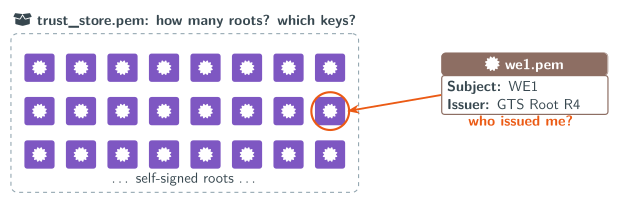

# Task 2: look into a trust store

## The situation

A trust store is the list of root certificates that a program trusts without any proof. `trust_store.pem` is a copy of the trust store of Ubuntu 24.04 (package `ca-certificates` 20260816, taken from the Mozilla root program), copied on 15 November 2026: the same file that Python's `ssl` module reads on that system. `we1.pem` is the intermediate certificate WE1 that the server www.coventry.ac.uk sends. Find out what is in the store and which root issued WE1.



## Goal

Count what is in a real trust store and find the root that issued WE1.

## Ready for you

- `trust_store.pem`, `we1.pem`.
- `cert_ready.py` (a black box): `load_certs(path)` reads every certificate of a PEM file into a list; `load_cert`, `subject_of`, `valid_from`, `valid_until`, `signed_by` as in Task 1; `key_type(cert)` gives text such as `"RSA 4096"` or `"EC P-384"`.
- Dates can be compared with `<` and `>` like numbers.

## Steps

Write your code in place of the `TODO` comments in `look_into_store.py`. Under each `TODO` there is a line `print("not done yet: TODO n")`: replace it with your code.

1. Print how many roots are in the store (`len(store)`).
2. Count the roots that signed themselves: `store[i].subject == store[i].issuer`.
3. Count the roots with an RSA key and with an EC key: `key_type(store[i]).startswith("RSA")`.
4. Find the oldest root (the smallest `valid_from`) and the root that expires last (the largest `valid_until`), with one loop, as you would find a minimum in C. Print their subjects and dates.
5. Find the root whose subject equals `we1.issuer`, print its subject and key type, and check that it signed WE1 with `signed_by`.

## Expected output

Predict first: about how many roots? More RSA or more EC?

<details>
<summary>Check your answer</summary>

```
roots in the store: 120
self-signed: 120
RSA keys: 80  EC keys: 40
oldest: CN=Izenpe.com,O=IZENPE S.A.,C=ES from 2007-12-13
expires last: CN=SECOM TLS ECC Root CA 2024,O=SECOM Trust Systems Co.\, Ltd.,C=JP on 2049-01-14
WE1 was issued by: CN=GTS Root R4,O=Google Trust Services LLC,C=US EC P-384
signed WE1: True
```

All 120 roots are self-signed. Two thirds use RSA, but the newer roots use elliptic curves. WE1 was issued by GTS Root R4, which is in the store: that is where the chain of Task 1 ends.

</details>

## Run

```
python3 look_into_store.py
```

About 8 minutes. Python 3 and the library `cryptography` (`pip install cryptography`, version 41 or newer). No internet needed.
