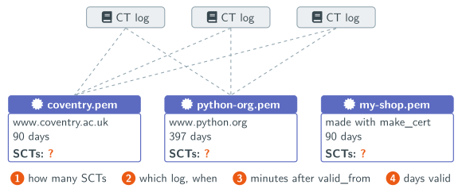

# Task 6: find the SCTs

## The situation

With Certificate Transparency, every public certificate is sent to public logs before it is issued, and each log answers with a Signed Certificate Timestamp (SCT): a signed promise to publish the certificate. The CA puts the SCTs inside the certificate, and browsers refuse public certificates without them. This folder holds two real certificates, saved on 15 November 2026 (`www.coventry.ac.uk` and `www.python.org`), and one made with `make_cert` that was never logged.



## Goal

Read the SCTs of two real certificates and of one that was never logged.

## Ready for you

- `coventry.pem`, `python-org.pem`, `my-shop.pem`.
- `cert_ready.py` (a black box): `load_cert`, `subject_of`, `issuer_of`, `valid_from`, `valid_until`; `scts_of(cert)` gives the list of SCTs inside a certificate (empty if there are none); for one SCT `s`, `s.log_id` is the ID of the log (bytes) and `sct_time(s)` the time when the log signed it.
- `ct_logs.py`: `LOGS[...]` turns a log ID, written in hex capitals (`s.log_id.hex().upper()`), into the name of the log. Copied from Google's list of logs on 15 November 2026.
- The difference of two dates is a duration: `(a - b).total_seconds()`.

## Steps

The loop over the three files is ready. Write your code in place of the `TODO` comments in `find_scts.py`:

1. Get the list of SCTs of the certificate with `scts_of` and print how many there are.
2. For each SCT print the name of its log and its time.
3. For each SCT print how many minutes lie between `valid_from(cert)` and the time of the SCT.
4. Print how many days the certificate is valid.

## Expected output

Predict first: how many SCTs has `my-shop.pem`?

<details>
<summary>Check your answer</summary>

```
coventry.pem : CN=www.coventry.ac.uk issued by CN=WE1,O=Google Trust Services,C=US
  valid from: 2026-10-13 02:29:16+00:00
  SCTs: 2
    DigiCert Sphinx2027h1 at 2026-10-13 03:29:17.226000+00:00
    Let's Encrypt Willow2027h1 at 2026-10-13 03:29:17.654000+00:00
    SCT 1 came 60.0 minutes after valid_from
    SCT 2 came 60.0 minutes after valid_from
  valid for 90 days

python-org.pem : CN=www.python.org issued by CN=GlobalSign Atlas R3 DV TLS CA 2025 Q4,O=GlobalSign nv-sa,C=BE
  valid from: 2026-01-13 13:03:46+00:00
  SCTs: 3
    Sectigo Elephant2027h1 at 2026-01-13 13:03:48.338000+00:00
    Cloudflare Nimbus2027 at 2026-01-13 13:03:48.312000+00:00
    Let's Encrypt Sycamore2027h1 at 2026-01-13 13:03:49.186000+00:00
    SCT 1 came 0.0 minutes after valid_from
    SCT 2 came 0.0 minutes after valid_from
    SCT 3 came 0.1 minutes after valid_from
  valid for 397 days

my-shop.pem : CN=my-shop.example issued by CN=my-shop.example
  valid from: 2026-11-15 16:13:15+00:00
  SCTs: 0
  valid for 90 days
```

The 90-day certificate has 2 SCTs, the 397-day one has 3: browsers ask for 2 SCTs when a certificate lives up to 180 days and 3 when it lives longer. The SCTs come seconds after issuance. In the Coventry certificate `valid_from` is one hour before the SCTs: its CA dates certificates back a little, which helps clients whose clock is slow. Our own certificate has no SCT: no browser would accept it as a public certificate.

</details>

## Run

```
python3 find_scts.py
```

About 7 minutes. Python 3 and the library `cryptography` (`pip install cryptography`, version 41 or newer). No internet needed.
